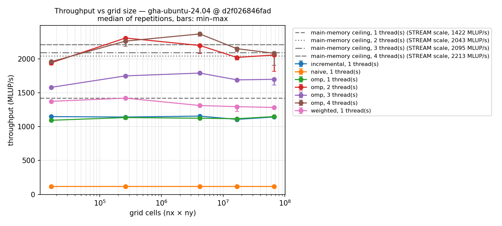

# advdiff2d-hpc-lab

[](https://github.com/ldenarie/advdiff2d-hpc-lab/actions/workflows/ci.yml)

> **Learning project - v0.1**

A 2D advection-diffusion kernel in C++, used to learn and practice parallel
programming (OpenMP, then MPI), vectorization and performance measurement.

## What this is

- A small, tested explicit finite-difference solver for a passive tracer on a
  periodic 2D grid: first-order upwind advection, centred diffusion, forward
  Euler. See [docs/model.md](docs/model.md).
- A playground for parallelization, with reproducible measurements and an
  honest discussion of their limits.

## What this is not

- Not a weather or climate model, nor a simplified version of one.
- Not a large-scale scalability study: measurements run on small free cloud
  machines (a few cores, one node).

## Status

| Step | Status |
|---|---|
| Sequential kernel and tests | done |
| Profiling | done |
| OpenMP | done |
| Vectorization | partially done |
| MPI (domain decomposition) | planned |
| Fortran version | planned |

## Build and test

Requires CMake >= 3.22, a C++20 compiler, OpenMP, Catch2 v3 (`catch2` on
Ubuntu), Python 3 and matplotlib for figures. The repository ships a dev
container with everything installed.

```sh
cmake -S . -B build -G Ninja -DCMAKE_BUILD_TYPE=Release
cmake --build build
ctest --test-dir build --output-on-failure
./build/advdiff2d kernel=omp nx=2048 ny=2048 steps=200 reps=3 warmup=1 output=text
```

## Results

This section summarizes the benchmark result of a single run, on a Zen 3
runner, available in `results/20261126T132002Z_gha-ubuntu-24.04`. A detailed
analysis of this run and of the other runs can be found in the
[Performance analysis document](docs/performance.md).

The first *naive* implementation showed a stable throughput ceiling at
**117 MLUP/s** independent of the field size. The limitation came from the
amount of computation in each cell update and the conditional branch inside the
for loop.

The cell update computation was then reformulated as a linear combination of the
cell value and the values of its neighbors (kernel *incremental*). This change
increased the performances significantly (up to a factor of almost 10 on a
512x512 field). The performance is still limited by the computation as we cannot
notice any performance reduction when the field size gets larger than the cache.

The parallel version using OpenMP allowed to increase the performances even
further (kernel *omp*). A 2 fold improvement can be observed compared to the
optimized sequential version for a 512x512 field (fits in L3 cache), with 2
threads. On larger field (4096x4096), the memory bandwidth becomes the limit,
and the improvement gets lower. Also, the 2 thread run on large grid already
reaches the STREAM ceiling. This explains why the SMT does not allow to improve
performances: the memory bandwidth is already saturated.

Earlier runs on a Zen 4 runner, analyzed in `docs/performance.md`, showed a
different bottleneck: the single-threaded kernel was limited by memory latency,
and the hardware threads (SMT) gained 25–30 % on large grids. The bottleneck
depends on the CPU: performance has to be measured on the target machine (see
[Performance analysis document](docs/performance.md) ).

Results summary for 512x512 field (fits in L3 cache):

| | naive | incremental | omp, 2 threads | omp, 4 threads |
|---|---|---|---|---|
| MLUP/s | 117.3 | 1141.9 | 2307.9 | 2262.3 |
| Improvement compared to previous step | - | x 9.7 (reformulation) | x 2.0 (2 threads) | x 1.0 (SMT) |
| Improvement compared to naive implementation | x 1 | x 9.7 (reformulation) | x 19.7 (2 threads) | x 19.3 (SMT) |

Results summary for 4096x4096 field (central memory):

| | naive | incremental | OMP, 2 threads | OMP, 4 threads |
|---|---|---|---|---|
| MLUP/s | 117.2 | 1107.3 | 2020.9 | 2149.8 |
| Improvement compared to previous step | - | x 9.4 (reformulation) | x 1.8 (2 threads) | x 1.1 (SMT) |
| Improvement compared to naive implementation | x 1 | x 9.4 (reformulation) | x 17.2 (2 threads) | x 18.3 (SMT) |
| Percentage of STREAM ceiling | 8 % | 78 % | 99 % | 97 % |

Note: the percentage of the STREAM ceiling is computed relative to the same
number of threads.

Comparison of the throughput of the different kernel relative to the field size:




## Use of AI assistance

The project skeleton and tooling (CMake, CI, dev container, specification draft,
benchmark bash script and python figures) were prepared with the help of an AI
assistant. The AI assistant also gave feedback to
the author under the form of code reviews. The kernels, parallelization, tests
and analysis are written by the author.
Commits prepared with the help of an AI assistant are marked "AI-assisted" in their message.

## Limits

See limits described [here](docs/benchmarking.md#4-limits-of-these-measurements).

## Next steps

- Vectorization with `-march=native`
- MPI
- Fortran kernel version

## Where to look

- [Problem description](docs/model.md)
- [Benchmarking process](docs/benchmarking.md)
- [Performance analysis](docs/performance.md)
- Raw data: `results/`

## License

MIT, see [LICENSE](LICENSE).
