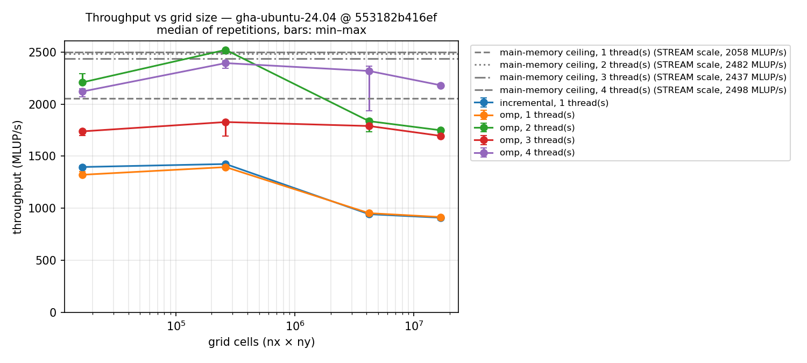

# Observations

The first [reference run](../results/20261109T141104Z_gha-ubuntu-24.04) reports
the following data:

| kernel | threads | grid | steps | reps | median MLUP/s | min–max | spread | eff. GB/s |
|---|---|---|---|---|---|---|---|---|
| seq | 1 | 128×128 | 12208 | 7 | 173.8 | 166.5–174.7 | 4.7 % | 4.17 |
| seq | 1 | 512×512 | 763 | 7 | 173.2 | 166.9–173.9 | 4.0 % | 4.16 |
| seq | 1 | 2048×2048 | 48 | 7 | 173.5 | 170.9–174.6 | 2.1 % | 4.16 |
| seq | 1 | 4096×4096 | 12 | 7 | 173.5 | 163.4–179.5 | 9.3 % | 4.16 |

We can observe that the throughput is approximately constant at ~173 MLUP/s,
meaning that the increase in the grid size does not slow down the processing.

**Hypothesis**: This suggests that the limit is in the processor operation, and
not in the memory bandwidth (otherwise, we would see an decrease when the size
of the grid increases, as the larger, but slower memory layers (caches) are
involved.).

# Analysis

## On the validity of performance comparison

The benchmarks run on GitHub Actions. As such, it is impossible to ensure that
two different job run on the same machine. Even on a single machine, it is
impossible to know the amount of resources that is allocated to our job. In
order to make fair comparisons between the different version of our kernel, one
should only compare runs that were performed on the same job. All comparison
made further in this document are made this way. In particular, this explains
why, depending on the table, the same kernel can have different measures.

## Count instructions read per cell update

In order to analyze where the time is spent, I used the callgrind tool from
valgrind.

First, the driver needs to be compiled with the debugging information. The usual
usage is to compile with `-DCMAKE_BUILD_TYPE=RelWithDebInfo`, but by default,
this option compiles with the optimization `O2`. In order to profile the same
program that we want to run at the end, it is necessary to compile with `O3`.
This can be done by just adding the option `-g`.

```
cmake -S . -B build-profile -G Ninja -DCMAKE_BUILD_TYPE=Release -DCMAKE_CXX_FLAGS=-g
cmake --build build-profile/
```

Then, I can run callgrind with a short execution of the program, and get the
output.

```
valgrind --tool=callgrind ./build-profile/advdiff2d nx=256 ny=256 steps=20 reps=1 warmup=0
callgrind_annotate
```

Here is a sample of the output showcasing the function call with the most
instruction reads:

```
--------------------------------------------------------------------------------
Ir                   file:function
--------------------------------------------------------------------------------
 45,875,220 (58.07%)  src/include/advdiff/details/kernel.hpp:advdiff::step_seq(advdiff::Field const&, advdiff::Field&, advdiff::Grid const&, advdiff::Physics const&, double)
 7,926,280 (10.03%)  src/kernel_seq.cpp:advdiff::step_seq(advdiff::Field const&, advdiff::Field&, advdiff::Grid const&, advdiff::Physics const&, double) [/workspaces/advdiff2d-hpc-lab/build-profile/advdiff2d]
 7,884,800 ( 9.98%)  include/advdiff/problem.hpp:advdiff::step_seq(advdiff::Field const&, advdiff::Field&, advdiff::Grid const&, advdiff::Physics const&, double)
 6,553,640 ( 8.30%)  include/advdiff/field.hpp:advdiff::step_seq(advdiff::Field const&, advdiff::Field&, advdiff::Grid const&, advdiff::Physics const&, double)
 2,162,688 ( 2.74%)  ./math/../sysdeps/ieee754/dbl-64/e_exp.c:__ieee754_exp_fma [/usr/lib/x86_64-linux-gnu/libm.so.6]
 1,310,860 ( 1.66%)  /usr/include/c++/13/bits/stl_vector.h:advdiff::step_seq(advdiff::Field const&, advdiff::Field&, advdiff::Grid const&, advdiff::Physics const&, double)
 1,310,720 ( 1.66%)  ./math/./w_exp_template.c:exp@@GLIBC_2.29 [/usr/lib/x86_64-linux-gnu/libm.so.6]
   788,220 ( 1.00%)  src/main.cpp:main [/workspaces/advdiff2d-hpc-lab/build-profile/advdiff2d]
   592,128 ( 0.75%)  include/advdiff/problem.hpp:main
```

We can see that most of the time is spent in the kernel, for a total of
68,239,940 instruction reads. Relative to the number of cell update (nx * ny *
steps), it makes 52 instruction read per cell update.

# What did the compiler optimized

I temporarily added the `-fopt-info-vec-optimized -fopt-info-vec-missed` flags
to the compilation of `kernel_seq.cpp`.

The compilation of `kernel_seq.cpp` now outputs:

```
/src_dir/src/kernel_seq.cpp:16:23: missed: couldn't vectorize loop
/src_dir/src/kernel_seq.cpp:17:21: missed: not vectorized: no vectype for stmt: _3 = MEM[(double &)_57];
 scalar_
/src_dir/src/kernel_seq.cpp:12:23: optimized: loop vectorized using 16 byte vectors
/src_dir/src/kernel_seq.cpp:12:23: optimized:  loop versioned for vectorization because of possible aliasing
/src_dir/src/kernel_seq.cpp:23:23: missed: couldn't vectorize loop
/src_dir/src/kernel_seq.cpp:23:23: missed: not vectorized: control flow in loop.
/src_dir/src/kernel_seq.cpp:24:27: missed: couldn't vectorize loop
/src_dir/src/kernel_seq.cpp:24:27: missed: not vectorized: control flow in loop.
/src_dir/src/kernel_seq.cpp:32:23: missed: couldn't vectorize loop
/src_dir/src/kernel_seq.cpp:32:23: missed: not vectorized: control flow in loop.
/src_dir/src/kernel_seq.cpp:33:27: missed: couldn't vectorize loop
/src_dir/src/kernel_seq.cpp:33:27: missed: not vectorized: control flow in loop.
/src_dir/src/kernel_seq.cpp:49:23: missed: couldn't vectorize loop
/src_dir/src/kernel_seq.cpp:49:23: missed: not vectorized: control flow in loop.
/usr/inctl_numeric.h:140:22: optimized: loop vectorized using 16 byte vectors
/src_dir/src/kernel_seq.cpp:57:23: missed: couldn't vectorize loop
/src_dir/src/kernel_seq.cpp:57:23: missed: not vectorized: loop nest containing two or more consecutive inner loops cannot be vectorized
/usr/inctl_algo.h:5650:24: missed: couldn't vectorize loop
/src_dir/src/kernel_seq.cpp:55:8: missed: not vectorized: unsupported use in stmt.
/src_dir/src/kernel_seq.cpp:66:23: missed: couldn't vectorize loop
/src_dir/src/kernel_seq.cpp:66:23: missed: not vectorized: loop nest containing two or more consecutive inner loops cannot be vectorized
/usr/inctl_algo.h:5714:24: missed: couldn't vectorize loop
/src_dir/src/kernel_seq.cpp:64:8: missed: not vectorized: unsupported use in stmt.
```

The loops involved in the kernel functions are the one in lines 32 and 33. Both
were not vectorized because of "control flow in loop". One possible reason is
that the content of the loop involves a conditional execution (the advection
term depends on the signs of the velocity components u and v).

The fact that the compiler does not vectorize the loop only explains part of why
the throughput is so low. Another possible explanation is the number of operation
in each cell update. For every cell, multiple terms are computed, and these
computation involves double floating point divisions, which are very costly
compared to other operation.

# Optimization

## Remove conditional in for loop

Let's try to remove the conditional in the for loop so that the compiler can
vectorize it.  There are several possibilities. Probably, the one with the most
performance is isolate each possible branch in its own function, and call a
different for loop in each case. But this will be my second choice. My first
choice will be to add both term instead of using the conditional, and add
factors 1. and 0. that make the kernel only add the right value. This is my
first choice because that will allow me to check that the for loop is indeed
factorized.

After this change, the compiler reports that the inner loop (the one in `j`) was
vectorized. A new call to valgrind callgrind tool shows that the total number of
instruction read is 28'683'600. That makes around 22 instruction read per cell
update. Which is much better than the 52 that we had in the beginning.

There are still a lot of computation, including divisions, performed in each
cell update. This is particularly true because the kernel now computes useless
terms which are then canceled after a multiplication by 0.

## Remove conditional in the for loop

Now that we showed that the for loop can be vectorized and that it makes a big
difference, we can implement a version that does not compute the terms that will
be canceled by the multiplication by a factor 0. What we definitely do not want
is to write 4 different for loops for each combination of u and v signs. This
solution would work, but it would never scale for an equation more complex.

The main thing to notice is that the condition is not dependent on the cell. So
the result will be exactly the same for each cell in a single field update. And
the formula to update a cell is just a linear combination of the value of the
cell and the values of its neighbors. The factors associated to each cell in the
linear combination is the same for each cell. As such, they can be computed
outside of the loop. Actually, this is the formulation of the update written in
[the equation at §3 in the model
description](model.md#stability-and-maximum-principle). Seen individually, this
equation seems to involve more computation than the original formulation, with
the conditionals, but as the weight can be computed only one time for all the
cells, it is much more efficient to do it this way.

After implementing this version, the compiler still vectorizes the loop. The
number of instruction read per cell update now drops to 9.

But with this implementation the test that checks that a uniform field is
unchanged now fails. The sum of the factors is indeed not perfectly 1 (because
of numerical errors), and as such, the uniform field is not perfectly unchanged.
It is in theory possible to make the computation enforce the fact that a
uniform field is unchanged. By writing the update in the following manner:

```
c_new(i,j) = c(i,j) + (Cx+Dx) (c(i-1,j) - c(i,j)) + Dx (c(i+1,j) - c(i,j)) + (Cy+Dy) (c(i,j-1) - c(i,j)) + Dy (c(i,j+1) - c(i,j))
```

This incremental formulation ensure that a uniform field is unchanged as each
difference is 0. The price for this added precision is that there is now 4
additional subtraction in place of one subtraction and a multiplication. This
is a compromise that must be chosen using a proper measure. Running valgrind
callgrind tool, it shows that the number of instruction read per cell update is
now 10, which is a bit higher than 9. Running the benchmark on the CI, it show
the following numbers:

| kernel | threads | grid | steps | reps | median MLUP/s | min–max | spread | eff. GB/s | % of ceiling |
|---|---|---|---|---|---|---|---|---|---|
| incremental | 1 | 128×128 | 12208 | 7 | 1409.2 | 1406.2–1418.0 | 0.8 % | 33.82 | 70 % |
| incremental | 1 | 512×512 | 763 | 7 | 1357.3 | 1353.7–1358.7 | 0.4 % | 32.57 | 68 % |
| incremental | 1 | 2048×2048 | 48 | 7 | 946.5 | 937.6–968.1 | 3.2 % | 22.72 | 47 % |
| incremental | 1 | 4096×4096 | 12 | 7 | 897.5 | 885.5–900.1 | 1.6 % | 21.54 | 45 % |
| naive | 1 | 128×128 | 12208 | 7 | 135.5 | 135.3–135.5 | 0.2 % | 3.25 | 7 % |
| naive | 1 | 512×512 | 763 | 7 | 135.1 | 135.0–135.1 | 0.1 % | 3.24 | 7 % |
| naive | 1 | 2048×2048 | 48 | 7 | 135.1 | 135.1–135.2 | 0.1 % | 3.24 | 7 % |
| naive | 1 | 4096×4096 | 12 | 7 | 135.2 | 131.6–135.3 | 2.7 % | 3.24 | 7 % |
| weighted | 1 | 128×128 | 12208 | 7 | 1738.2 | 1697.6–1768.5 | 4.1 % | 41.72 | 87 % |
| weighted | 1 | 512×512 | 763 | 7 | 1763.9 | 1755.0–1769.3 | 0.8 % | 42.33 | 88 % |
| weighted | 1 | 2048×2048 | 48 | 7 | 979.3 | 968.2–987.8 | 2.0 % | 23.50 | 49 % |
| weighted | 1 | 4096×4096 | 12 | 7 | 944.0 | 940.8–952.8 | 1.3 % | 22.66 | 47 % |

Going from the naive to the optimized version goes from 135 to 1764 MLUP/s (for
a 512 times 512 grid). While going from the optimized version to the one that is
optimized but is more precise only drops down to 1357 MLUP/s. For sake of
precision (which is important on long run simulation), I would argue that the
version that keeps a uniform field unchanged is worth it. This is especially
true because for larger grids, the limitation is the memory bandwidth, so the
difference between the weighted and incremental version is even lower. Also, one
thing that must be noted is that the kernel I decided to call more precise seems
to be indeed more precise. The total mass relative error for the incremental
kernel shows that in the data. On a coarser grid (128 x 128), the total mass
relative error stays in the order of magnitude of 1e-16. For the weighted
kernel, this error goes up to 1e-12 (in order of magnitude). For the sake of
this experiment, I will just keep the two kernel versions available.

For both the weighted and incremental kernel, we can observe that the throughput
drops when the size of the grid increase. This suggests that it is limited by
the memory bandwidth. But the limit is still around 50 % of the ceiling (scale
mini-STREAM). There are multiple hypothesis that could explain this large
difference. I chose not to explore these for now. I might come back later on
this subject after the parallel implementation.

# Parallelization

## Setup

There are multiple question that must be answered to make a proper parallelization.

### Which loop should be parallelized ?

In the kernel, there two nested loop.  Both can in theory be parallelized. But
it may not be interesting to parallelized both. I will only parallelize the
outer loop for multiple reasons:

- There is a fix cost at every parallelization block. If the work is done in the
  inner loop, it is paid at each iteration of the outer loop. Both loop could be
  in the same parallel block though.

- On this project, I only have a very few number of threads (up to 4). In all
  the interesting cases, all thread will be fully used, by far. There is no gain
  in trying to split the work inside the inner loop. It would not increase the
  number of parallel jobs.

### Which schedule policy ?

Each row has a fixed size. There is no reason to think a dynamic or guided
schedule would produce better results.

### Should `apply_periodic_bc` be parallelized ?

`apply_periodic_bc` is ran one time after each step. As such, it is a good
candidate for parallelization. But lets consider the actual amount of
computation occurring in this function to evaluate if it is even worth
considering it.

In the kernel step function, the number of instruction read is the dimension of
the field (`nx * ny`) multiplied by the number of instruction read in every cell
update (as we saw before, around 10). So a total of `10 (nx * ny)`. In the
`apply_periodic_bc` function, each ghost cell update is a single read and write.
And there are `2 (nx + ny)` number of update. With a grid size of 128, this
represent 0.3 % of the computation required by a kernel step. And this ration
decreases when the size of the grid increases. Considering our grid size and the
duration of our computation. This place is not the priority.

## Performance gain prediction

This section describes the changes that I am expecting with the OMP version of
the kernel.

The virtual machine on which the simulation are running, in GitHub Action, have
a x86_64 architecture, with 2 cores, and 2 threads for each core. So there can
be, in theory, up to 4 parallel threads. But 2 of those threads are virtual
threads.  There are 3 levels of cache :

- L1: between 32 and 48 KiB (depending on the machine) per core.

- L2: 1MiB per core.

- L3: 32MiB for the while VM (and probably even shared with other VM on the same
  physical machine, so subject to noise depending on the usage).

The benchmark field sizes fits in the cache as following:

- 128²: larger than L1, but fits in L2.

- 512²: larger than L2, but fits in L3 (in theory).

- 2048²: larger than L3 (but not by a lot, and L3 is not reserved to our own
  usage, so should be considered outside of L3).

- 4096²: larger than L3.

For grids that fit in the cache, I would expect the OMP version of the kernel to
be significantly faster. With 2 threads, if the 2 fold improvement will probably
not be reached, something close can be expected. With 3 or 4 thread, though, I
would not expect any additional improvement as these are SMT threads running on
the same cores.

For grids larger than the cache, I would expect small improvements but with a
threshold caused by the memory read. For 2 threads, this threshold should be
equivalent to the threshold of the STREAM test for the same number of threads.
Again, no additional gains are expected on 3 or 4 threads.

## Result analysis

Here is the summary of the results:

| kernel | threads | grid | steps | reps | median MLUP/s | min–max | spread | eff. GB/s | % of ceiling |
|---|---|---|---|---|---|---|---|---|---|
| incremental | 1 | 128×128 | 12208 | 7 | 1396.2 | 1387.1–1409.5 | 1.6 % | 33.51 | 68 % |
| incremental | 1 | 512×512 | 763 | 7 | 1424.8 | 1421.5–1425.8 | 0.3 % | 34.20 | 69 % |
| incremental | 1 | 2048×2048 | 48 | 7 | 942.7 | 921.4–945.4 | 2.5 % | 22.63 | 46 % |
| incremental | 1 | 4096×4096 | 12 | 7 | 909.0 | 889.6–913.7 | 2.7 % | 21.82 | 44 % |
| omp | 1 | 128×128 | 12208 | 7 | 1321.5 | 1320.8–1351.8 | 2.3 % | 31.72 | 64 % |
| omp | 1 | 512×512 | 763 | 7 | 1395.2 | 1391.3–1400.0 | 0.6 % | 33.48 | 68 % |
| omp | 1 | 2048×2048 | 48 | 7 | 952.7 | 940.5–956.5 | 1.7 % | 22.86 | 46 % |
| omp | 1 | 4096×4096 | 12 | 7 | 915.3 | 906.7–919.0 | 1.4 % | 21.97 | 44 % |
| omp | 2 | 128×128 | 12208 | 7 | 2209.3 | 2193.9–2294.4 | 4.6 % | 53.02 | 89 % |
| omp | 2 | 512×512 | 763 | 7 | 2521.9 | 2485.7–2527.4 | 1.7 % | 60.53 | 102 % |
| omp | 2 | 2048×2048 | 48 | 7 | 1836.9 | 1733.9–1856.6 | 6.7 % | 44.09 | 74 % |
| omp | 2 | 4096×4096 | 12 | 7 | 1749.1 | 1727.1–1755.8 | 1.6 % | 41.98 | 70 % |
| omp | 3 | 128×128 | 12208 | 7 | 1738.6 | 1700.6–1741.2 | 2.3 % | 41.73 | 71 % |
| omp | 3 | 512×512 | 763 | 7 | 1828.3 | 1695.0–1830.7 | 7.4 % | 43.88 | 75 % |
| omp | 3 | 2048×2048 | 48 | 7 | 1790.1 | 1785.0–1795.9 | 0.6 % | 42.96 | 73 % |
| omp | 3 | 4096×4096 | 12 | 7 | 1695.5 | 1686.1–1750.8 | 3.8 % | 40.69 | 70 % |
| omp | 4 | 128×128 | 12208 | 7 | 2121.5 | 2070.1–2146.0 | 3.6 % | 50.92 | 85 % |
| omp | 4 | 512×512 | 763 | 7 | 2394.7 | 2346.7–2414.6 | 2.8 % | 57.47 | 96 % |
| omp | 4 | 2048×2048 | 48 | 7 | 2319.0 | 1937.4–2364.3 | 18.4 % | 55.66 | 93 % |
| omp | 4 | 4096×4096 | 12 | 7 | 2181.7 | 2168.8–2196.7 | 1.3 % | 52.36 | 87 % |

And here is the graph that shows the throughput comparison:



First, lets consider the STREAM data. We can notice that the throughput
significantly increases when there is more than 1 thread. This shows the fact
that, even though the STREAM run on 1 thread is limited by the memory bandwidth,
the 1 thread does not constantly access the memory. Running the STREAM on 2
threads makes the demand on memory higher and get closer to the memory final
limit. The runs on 3 and 4 threads are not faster as they are running on the
same cores. As such, the memory throughput is already maximal with 2 threads. We
can observe a small decrease of the throughput with 3 threads. This decrease is
too small to commit to an explanation. It might just be run variability. Or it
might come from the fact that 2 threads are running  on the same physical core.
With 4 thread, the same performance are achieved as what is achieved with 2
threads.

Regarding our kernel now: The first thing we can notice is that the 1 thread runs
of the OMP kernel are slightly slower than the incremental version of the
kernel. The difference decreases with the grid size. This is probably caused by
the additional cost implied by OMP (which is totally useless in the 1 thread
case). With larger grids, this cost is masked because the limit is now the
memory bandwidth.

With 2 or more threads, all the OMP kernel exceed the sequential version in
throughput.

More precisely, with 2 threads, the throughput is maximal with the 512x512
field. This field fits in the L3 cache, which is much faster than the central
memory. On smaller field, the throughput is lower. This is because, with a
smaller field, the constant cost of setting the OMP parallel section is paid
more often. This cost is consequent on small fields and must not be neglected.
We could expect the throughput to be even below the sequential kernel if the
field was even smaller. On larger fields, the throughput gets lower. This is
probably caused by the memory access which are becoming the limit.

With 3 threads, the throughput is lower than with 2 threads. This can be
explained by the fact that, with 3 threads, there are 2 threads running on the
same physical core. Those 2 threads are given the same amount of data to compute
as the 3rd thread on the second core. But those threads are going slower, and
they are the ones limiting the total throughput. We cannot see a significant
decrease in throughput with larger grids. This is probably because the limit
with larger fields is the memory bandwidth (the field does not fit in the
cache). The 2 threads on the same core are waiting in parallel.

With 4 threads, the balance between the two cores is restored. The throughput
gets close to the 2 thread runs on smaller fields, and even get higher on larger
fields. With 2 threads, the memory limit is reached faster because there is some
times when the thread is doing some computation and not doing some memory read
and write. With 4 threads, the memory access are more evenly spread, allowing to
benefit from a better global memory effective throughput. I am not sure why the
throughput on smaller field is slightly smaller than the one with 2 threads.
This might be caused by the cost of setting up the 4 threads, but this is just
an hypothesis.

## Final run

In order to show the performance progression along all the modifications, a
final run was launched (data available in
`results/20261126T132002Z_gha-ubuntu-24.04`). This run was performed on a
different machine than the previous run. The previous run was executed on Zen 4,
while this run was performed on Zen 3. The results show significant differences.

| kernel | threads | grid | steps | reps | median MLUP/s | min–max | spread | eff. GB/s | % of ceiling |
|---|---|---|---|---|---|---|---|---|---|
| incremental | 1 | 128×128 | 12208 | 7 | 1148.2 | 1145.6–1149.1 | 0.3 % | 27.56 | 81 % |
| incremental | 1 | 512×512 | 763 | 7 | 1141.9 | 1131.0–1144.1 | 1.1 % | 27.41 | 80 % |
| incremental | 1 | 2048×2048 | 48 | 7 | 1155.5 | 1141.6–1159.4 | 1.5 % | 27.73 | 81 % |
| incremental | 1 | 4096×4096 | 12 | 7 | 1107.3 | 1100.9–1111.5 | 1.0 % | 26.58 | 78 % |
| incremental | 1 | 8192×8192 | 3 | 7 | 1142.4 | 1138.8–1153.0 | 1.2 % | 27.42 | 80 % |
| naive | 1 | 128×128 | 12208 | 7 | 117.3 | 117.2–117.4 | 0.2 % | 2.82 | 8 % |
| naive | 1 | 512×512 | 763 | 7 | 117.3 | 116.8–117.4 | 0.5 % | 2.81 | 8 % |
| naive | 1 | 2048×2048 | 48 | 7 | 117.2 | 116.0–117.3 | 1.1 % | 2.81 | 8 % |
| naive | 1 | 4096×4096 | 12 | 7 | 117.2 | 117.1–117.3 | 0.2 % | 2.81 | 8 % |
| naive | 1 | 8192×8192 | 3 | 7 | 117.1 | 117.0–117.2 | 0.1 % | 2.81 | 8 % |
| omp | 1 | 128×128 | 12208 | 7 | 1094.0 | 1090.4–1095.8 | 0.5 % | 26.26 | 77 % |
| omp | 1 | 512×512 | 763 | 7 | 1134.2 | 1111.8–1135.0 | 2.0 % | 27.22 | 80 % |
| omp | 1 | 2048×2048 | 48 | 7 | 1124.4 | 1112.3–1127.6 | 1.4 % | 26.99 | 79 % |
| omp | 1 | 4096×4096 | 12 | 7 | 1117.4 | 1116.9–1119.9 | 0.3 % | 26.82 | 79 % |
| omp | 1 | 8192×8192 | 3 | 7 | 1148.8 | 1127.0–1158.0 | 2.7 % | 27.57 | 81 % |
| omp | 2 | 128×128 | 12208 | 7 | 1942.3 | 1909.6–1946.8 | 1.9 % | 46.61 | 95 % |
| omp | 2 | 512×512 | 763 | 7 | 2307.9 | 2284.6–2315.8 | 1.4 % | 55.39 | 113 % |
| omp | 2 | 2048×2048 | 48 | 7 | 2197.8 | 2079.1–2208.9 | 5.9 % | 52.75 | 108 % |
| omp | 2 | 4096×4096 | 12 | 7 | 2020.9 | 1983.0–2026.5 | 2.2 % | 48.50 | 99 % |
| omp | 2 | 8192×8192 | 3 | 7 | 2057.6 | 1815.7–2065.4 | 12.1 % | 49.38 | 101 % |
| omp | 3 | 128×128 | 12208 | 7 | 1580.0 | 1574.3–1581.3 | 0.4 % | 37.92 | 75 % |
| omp | 3 | 512×512 | 763 | 7 | 1749.4 | 1748.3–1752.4 | 0.2 % | 41.99 | 84 % |
| omp | 3 | 2048×2048 | 48 | 7 | 1790.4 | 1778.5–1794.7 | 0.9 % | 42.97 | 85 % |
| omp | 3 | 4096×4096 | 12 | 7 | 1690.4 | 1676.5–1692.9 | 1.0 % | 40.57 | 81 % |
| omp | 3 | 8192×8192 | 3 | 7 | 1698.2 | 1615.3–1708.2 | 5.5 % | 40.76 | 81 % |
| omp | 4 | 128×128 | 12208 | 7 | 1958.2 | 1916.9–1966.6 | 2.5 % | 47.00 | 88 % |
| omp | 4 | 512×512 | 763 | 7 | 2262.3 | 2185.2–2282.5 | 4.3 % | 54.30 | 102 % |
| omp | 4 | 2048×2048 | 48 | 7 | 2367.9 | 2334.6–2381.0 | 2.0 % | 56.83 | 107 % |
| omp | 4 | 4096×4096 | 12 | 7 | 2149.8 | 2108.4–2170.1 | 2.9 % | 51.60 | 97 % |
| omp | 4 | 8192×8192 | 3 | 7 | 2082.9 | 1904.8–2104.9 | 9.6 % | 49.99 | 94 % |
| weighted | 1 | 128×128 | 12208 | 7 | 1373.5 | 1357.8–1376.8 | 1.4 % | 32.97 | 97 % |
| weighted | 1 | 512×512 | 763 | 7 | 1420.7 | 1404.6–1423.0 | 1.3 % | 34.10 | 100 % |
| weighted | 1 | 2048×2048 | 48 | 7 | 1312.0 | 1306.7–1314.4 | 0.6 % | 31.49 | 92 % |
| weighted | 1 | 4096×4096 | 12 | 7 | 1295.0 | 1223.5–1310.4 | 6.7 % | 31.08 | 91 % |
| weighted | 1 | 8192×8192 | 3 | 7 | 1283.6 | 1276.5–1290.8 | 1.1 % | 30.81 | 90 % |

The first noticeable thing is that the sequential kernel are no longer limited
by memory on larger fields. The limit is the computational power. As a
consequence, the `weighted` kernel is faster than the `incremental` kernel even
on larger fields. The memory bandwidth only becomes the limit with 2 threads or
more.

Also, we can see that the STREAM ceiling is reached by the omp kernel running
with 2 threads on fields that do not fit in the cache: 99 % for a 4096x4096
fields, and about 100 %, ie. at  the ceiling within measurement noise, for the
8192x8192 field. This suggests that the memory bandwidth is saturated with only
2 threads. This explains why there is no further improvement with 4 threads. The
fact that there is 2 additional thread cannot increase the memory access by
adding more demands as the memory is already saturated.

These results shows that the performances of a kernel is dependent on the
hardware used. When tuning a system to optimize performances, it is important to
run the benchmarks on the target hardware.

Additionally, the choice to favor the kernel `incremental` compared to
`weighted` was done with the argument that the performance difference was
minimal with large fields. This last test shows that a different hardware may
make this difference larger. The conflict between performance and precision that
was arbitrated before in favor of `incremental` may yield a different choice
depending on the hardware.